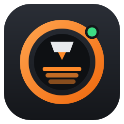
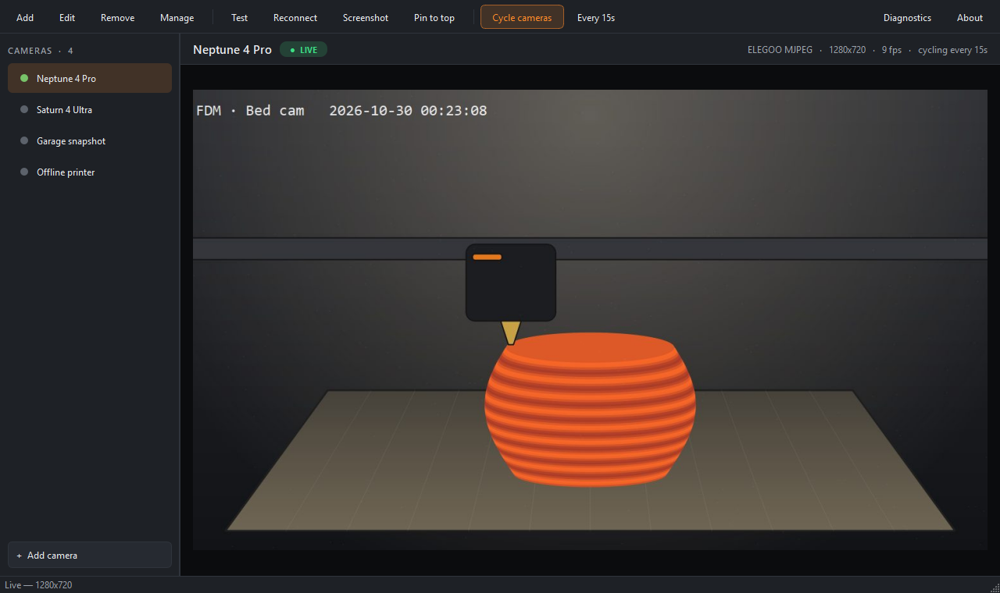
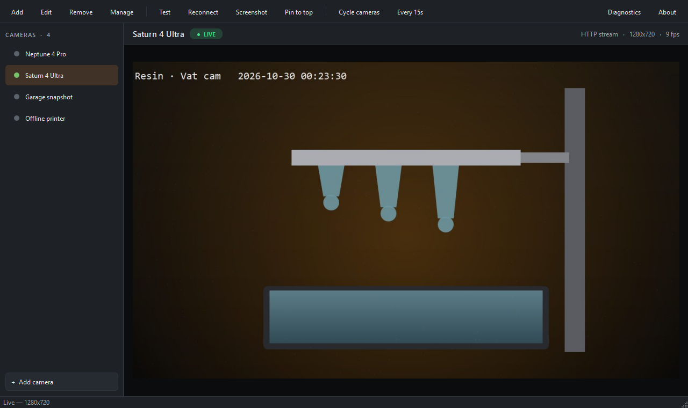
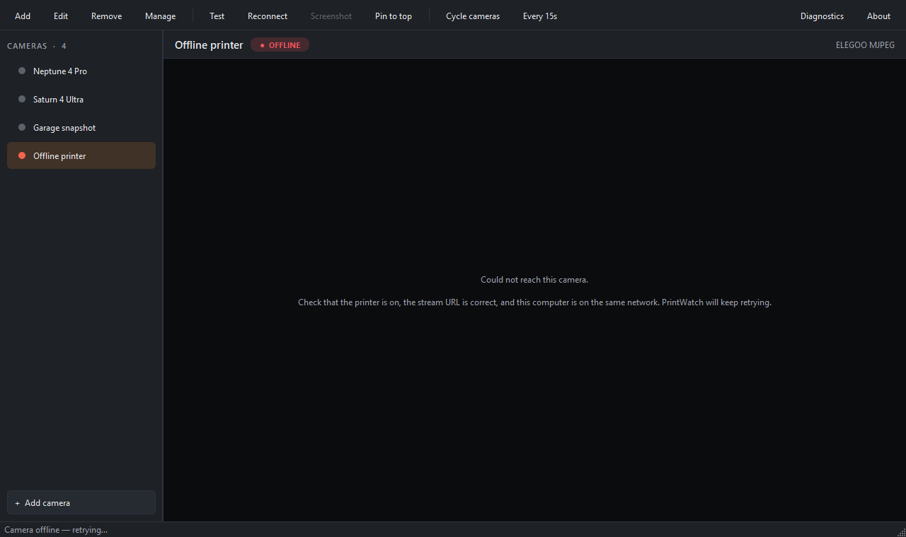
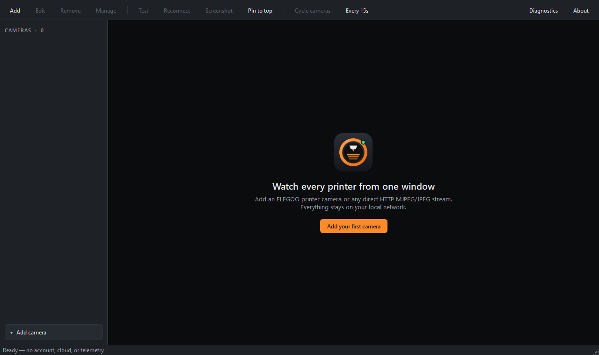

<div align="center">



# PrintWatch Desktop

**Every 3D-printer camera in one small desktop window.**
Watch your FDM and resin printers side by side with your slicer — no phone, no browser tabs,
no cloud account.

[](https://github.com/antonflor/elegoo-webcam-viewer/actions/workflows/ci.yml)
[](LICENSE)




</div>

## Features

- **Multiple cameras, one window.** Add every printer, then switch from the sidebar or with
  <kbd>Ctrl</kbd>+<kbd>Tab</kbd>.
- **Auto-cycle.** Rotate through your enabled cameras on a timer from 5 seconds to an hour,
  in the order you choose.
- **Clear connection status.** Each camera shows a Live / Connecting / Offline badge plus
  resolution and frame rate. Dropped streams reconnect on their own with backoff.
- **One-click connection test.** Confirms the URL returns a real JPEG frame, not just an open
  port.
- **Full-resolution screenshots.** Saves the original camera frame as PNG or JPEG.
- **Pin to top.** Keep a small camera window above your slicer or terminal.
- **Private by design.** No account, analytics, telemetry, or cloud relay. Video goes straight
  from the printer to your computer.
- **Light.** A native Qt MJPEG pipeline with no embedded browser; about a 95 MB install.

| Resin printer | Camera offline | First run |
|---|---|---|
|  |  |  |

<sub>Screenshots use the bundled demo camera (`scripts/demo_camera.py`), which draws simulated
printer feeds.</sub>

## Supported cameras

| Camera | Example URL |
|---|---|
| ELEGOO printers with the built-in MJPEG camera | `http://<printer-ip>:3031/video` |
| Any direct MJPEG stream (OctoPrint/mjpg-streamer, Crowsnest, ESP32-CAM, IP cameras) | `http://<host>:8080/?action=stream` |
| A direct JPEG snapshot URL (refreshed automatically) | `http://<host>/snapshot.jpg` |

Not supported yet: HTML camera dashboards, HLS, WebRTC, and RTSP. URLs with embedded
credentials (`http://user:pass@…`) are rejected because settings are stored as plain local JSON.

> [!TIP]
> To find an ELEGOO printer's IP address, open the network/Wi-Fi screen on the printer, or look
> it up in your router's list of connected devices. Use **Test** after adding a camera to
> confirm the stream works.

## Install

### Download

Prebuilt Windows (installer and portable ZIP), macOS (Apple Silicon), and Linux bundles are
published on the [Releases page](https://github.com/antonflor/elegoo-webcam-viewer/releases).
Beta builds are not code-signed yet, so Windows SmartScreen and macOS Gatekeeper will ask you
to confirm the first launch.

### From source

Requires Python **3.11 or 3.12**.

```bash
git clone https://github.com/antonflor/elegoo-webcam-viewer.git
cd elegoo-webcam-viewer
python -m venv .venv
# Windows: .venv\Scripts\activate     macOS/Linux: source .venv/bin/activate
pip install -e .
printwatch
```

<details>
<summary>Arch / CachyOS</summary>

```bash
sudo pacman -S --needed python python-pip
python -m venv .venv && source .venv/bin/activate
pip install -e .
printwatch
```

</details>

## Usage

1. Click **Add your first camera**, give it a name, and paste the stream URL.
2. Press **Test** to check that the camera sends frames.
3. Add more printers, then turn on **Cycle cameras** to rotate between them automatically.
4. Use **Manage** to hide cameras or change the cycle order.

| Shortcut | Action |
|---|---|
| <kbd>Ctrl</kbd>+<kbd>N</kbd> | Add camera |
| <kbd>Ctrl</kbd>+<kbd>E</kbd> | Edit camera |
| <kbd>Ctrl</kbd>+<kbd>T</kbd> | Test connection |
| <kbd>F5</kbd> | Reconnect |
| <kbd>Ctrl</kbd>+<kbd>Tab</kbd> / <kbd>Ctrl</kbd>+<kbd>Shift</kbd>+<kbd>Tab</kbd> | Next / previous camera |
| <kbd>Ctrl</kbd>+<kbd>L</kbd> | Toggle auto-cycle |
| <kbd>Ctrl</kbd>+<kbd>Shift</kbd>+<kbd>S</kbd> | Save screenshot |
| <kbd>Ctrl</kbd>+<kbd>Shift</kbd>+<kbd>T</kbd> | Pin window on top |

On macOS, use <kbd>Cmd</kbd> in place of <kbd>Ctrl</kbd>.

## Privacy and security

- Settings live in your user config folder; logs rotate and redact URLs, IP addresses, and
  your home folder path.
- **Diagnostics** exports a ZIP for bug reports that leaves out camera names, hosts, notes,
  tokens, and images. Review it before sharing.
- Printer camera streams are plain HTTP. Keep them on a trusted LAN or a VPN you control, and
  never forward a printer camera port to the internet.

See [SECURITY.md](SECURITY.md) to report a vulnerability.

## Development

```bash
pip install -e ".[dev]"
ruff check . && ruff format --check .
pytest                                  # unit + local-network integration tests
python scripts/demo_camera.py           # simulated cameras at http://127.0.0.1:3031
```

The demo server provides `/video` (FDM), `/resin` (resin), and `/snapshot` (single JPEG), so
you can work on the app without a printer.

Package a native build (it must run on each target OS):

```bash
pyinstaller --clean --noconfirm packaging/printwatch.spec
```

Pushing a `v*` tag builds Windows, macOS, and Linux artifacts with checksums and build
provenance, then publishes a GitHub Release. See [CONTRIBUTING.md](CONTRIBUTING.md).

### Project documents

- [`docs/SDD.md`](docs/SDD.md): product specification
- [`docs/RELEASE_PLAN.md`](docs/RELEASE_PLAN.md): release gates and milestones
- [`docs/ADR-0001-native-mjpeg.md`](docs/ADR-0001-native-mjpeg.md): why there is no embedded browser
- [`docs/MATRIX_INTEGRATION.md`](docs/MATRIX_INTEGRATION.md): integration strategy

## Why this exists

Phone apps are fine away from your desk, but at your desk you want a small window next to your
slicer. PrintWatch started as a way to watch an FDM printer and a resin printer at the same
time without reaching for a phone or juggling browser tabs.

## License

[MIT](LICENSE) © Anton Flor. Built with [Qt for Python (PySide6)](https://doc.qt.io/qtforpython-6/),
used under the LGPLv3; packaged builds ship Qt as separate, replaceable libraries.

PrintWatch Desktop is an independent project. It is not affiliated with, endorsed by, or
supported by ELEGOO. ELEGOO and Matrix are trademarks of their respective owners. PrintWatch is a
monitoring convenience, not a printer safety system: never leave a printer running unattended
on the strength of a camera feed alone.
